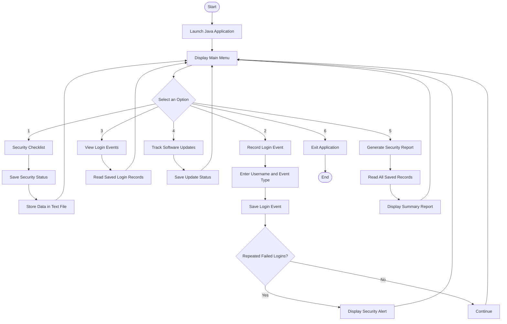

# 🔐 CyberSecurity Monitor

A lightweight **Java Swing desktop application** for **login monitoring**, **security checklist auditing** and **software update tracking** — all in one place, with no database server required.

> Course project — ICT-3108: Software Engineering and Project Management
> Department of ICT, Mawlana Bhashani Science and Technology University (MBSTU), Tangail

---

## 📌 Overview

Repeated failed logins, missing security practices and outdated software are among the most common weaknesses that go unnoticed until an incident happens. **CyberSecurity Monitor** brings these three concerns together in a simple, beginner-friendly tool and summarises them in one risk report.

## ✨ Features

| # | Menu option | What it does |
|---|-------------|--------------|
| 1 | **Security Checklist** | 8 recommended security practices with saved completion status and a score (%) |
| 2 | **Record Login Event** | Saves username, event type (SUCCESS / FAILED) and timestamp; rejects empty usernames |
| 3 | **View Login Events** | Shows all saved login events in a table |
| 4 | **Track Software Updates** | Records software name, version and status (UP-TO-DATE / PENDING) |
| 5 | **Generate Security Report** | Combines all data and rates the overall risk: **LOW / MEDIUM / HIGH** |
| 6 | **Exit** | Closes the application after confirmation |

🚨 **Security alert:** shown automatically when a user has **3 or more consecutive failed logins**.

## 🧮 Risk Rule

| Condition | Points |
|-----------|--------|
| Checklist score below 50% | +2 |
| Checklist score below 80% | +1 |
| Any user flagged for repeated failed logins | +2 |
| Any pending software update | +1 |

**4+ → HIGH**, **2–3 → MEDIUM**, otherwise **LOW**.

## 🔄 Application Workflow

The program starts, shows the main menu, branches on the selected option (1–6) and returns to the menu after every task. The only exit is option 6. After a login event is saved, the decision **"Repeated Failed Logins?"** leads either to a security alert (yes) or to the menu (no).



<details>
<summary>Workflow as an image</summary>


</details>

## 🗂️ Project Structure

```
CybersecurityMonitor/
├── Main.java                  # Swing window, menu and dialogs
├── SecurityChecklist.java     # Checklist items, score, save/load
├── LoginMonitor.java          # Login events, repeated-failure detection
├── SoftwareUpdateTracker.java # Update status tracking
├── SecurityReport.java        # Summary report and risk level
├── FileManager.java           # All file read/write operations
├── docs/
│   └── workflow.png           # Application workflow diagram
└── data/                      # Created automatically on first run
    ├── security.txt
    ├── login_events.txt
    └── software_updates.txt
```

## 🚀 Getting Started

### Requirements
- Java **11 or later** (developed with JDK 17)
- Windows, Linux or macOS

### Build and run

```bash
git clone https://github.com/<your-username>/CybersecurityMonitor.git
cd CybersecurityMonitor
javac *.java
java Main
```

The `data/` folder and its three text files are created automatically on the first run.

## 💾 Data Format

All records are stored as plain text, one record per line:

| File | Format |
|------|--------|
| `login_events.txt` | `timestamp\|username\|eventType` |
| `security.txt` | `description\|DONE or PENDING` |
| `software_updates.txt` | `software\|version\|status\|date` |

Corrupted lines are ignored, so the application does not crash on bad data. **No passwords are stored.**

## 🛠️ Tech Stack

- **Language:** Java (JDK 17)
- **GUI:** Swing
- **Storage:** Plain text files (`java.nio.file`)
- **Process model:** Incremental development with Scrum (4 sprints, 16 weeks)
- **Modelling:** UML (DFD, use case, activity, ER, class and object diagrams)

## 🧪 Testing

Manual test cases cover login recording, empty-username validation, repeated-failure alerts, checklist save/reload, update tracking, report generation, corrupted data lines and application exit. See the project proposal (Chapter 10) for the full test plan.

## ⚠️ Limitations

- Login events and update status are entered manually
- Data files are not encrypted
- Single-user application

## 🔮 Future Work

- Automatic reading of operating-system login logs
- PDF export of reports and e-mail alerts
- Migration from text files to SQLite
- Password-strength checker and charts of events over time

## 👤 Author

**Alif Ahmed Joy** 
- ID: IT24015
- 3rd Year 1st Semester, Session 2023–24,
- Department of ICT, MBSTU

**Supervisor:** Dr. Ziaur Rahman
- Professor
- Dept. of ICT, MBSTU

## 📄 License

This project was developed for educational purposes. Add a license of your choice (e.g. MIT) before publishing.
