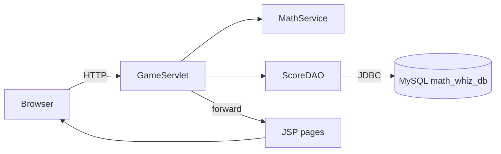

# 🎯 ALIF AHMED JOY – MATH WHIZ


A web-based mathematical game built with **Java Servlet, JSP and JDBC (MySQL)**.
The player enters a name, answers four questions (prime, modulus, two trigonometry), sees the final score, and the best scores appear on a **Top 10 leaderboard**. Every answer is calculated by Java methods, never stored manually.

---

## 📑 Table of Contents
1. [Author](#1-author)
2. [Project Objectives](#2-project-objectives)
3. [Features](#3-features)
4. [Technologies Used](#4-technologies-used)
5. [Software Requirements](#5-software-requirements)
6. [Project Structure](#6-project-structure)
7. [System Architecture](#7-system-architecture)
8. [Mathematical Functions](#8-mathematical-functions)
9. [Game Rules and Scoring](#9-game-rules-and-scoring)
10. [Database Configuration](#10-database-configuration)
11. [Steps to Run the Application](#11-steps-to-run-the-application)
12. [Welcome Page](#12-welcome-page)
13. [Game Page](#13-game-page)
14. [Result Page](#14-result-page)
15. [Leaderboard](#15-leaderboard)
16. [Database Table](#16-database-table)
17. [Testing and Validation](#17-testing-and-validation)
18. [Troubleshooting](#18-troubleshooting)
19. [GitHub Project Directory Link](#19-github-project-directory-link)

---

## 1. Author
| | |
|---|---|
| **Name** | Alif Ahmed Joy |
| **Student ID** | IT24015 |
| **Department** | Information and Communication Technology (ICT) |
| **University** | Mawlana Bhashani Science and Technology University (MBSTU) |

### Supervised By
**Dr. Ziaur Rahman**  
Professor  
Department of ICT, MBSTU

## 2. Project Objectives
- Build reusable Java methods for mathematical calculations.
- Calculate every answer in Java instead of using stored answers.
- Handle requests and responses with a Servlet and JSP pages.
- Save and read data with JDBC `PreparedStatement`.
- Show the ten highest scores in a leaderboard.
- Document and submit a complete project on GitHub.

## 3. Features
- Four generated questions per game: Prime, Modulus, Trigonometry, Trigonometry.
- Random questions each time; the two trigonometry questions use different functions.
- Server-side answer checking with input validation and a decimal tolerance.
- Score of 10 marks with a per-question result table (green = correct, red = wrong).
- Scores saved with player name, score, difficulty and date/time.
- Top 10 leaderboard sorted by score, then earlier time.
- HTML-escaped output to prevent XSS, and `PreparedStatement` to prevent SQL injection.
- Unit tests for all mathematical methods.

## 4. Technologies Used
| Layer | Technology |
|---|---|
| Language | Java 17 |
| Web | Jakarta Servlet 6, JSP |
| Database | MySQL 8, JDBC (`mysql-connector-j`) |
| Server | Apache Tomcat 10.1 |
| Build | Maven |
| Frontend | HTML5, CSS3 |
| Testing | JUnit 5 |

## 5. Software Requirements
- JDK 17 or newer
- Apache Tomcat **10.1+** (uses the `jakarta.*` namespace)
- MySQL Server 8+
- Maven 3.8+ (or IntelliJ IDEA's bundled Maven)

## 6. Project Structure
```
MathWhiz/
├── src/main/java/
│   ├── controller/GameServlet.java      # request handling
│   ├── model/                           # GameScore, Question, QuestionResult
│   ├── service/MathService.java         # all math logic and scoring
│   ├── dao/                             # ScoreDAO, DBConnection (JDBC)
│   └── util/Html.java                   # output escaping
├── src/main/resources/db.properties     # database settings
├── src/main/webapp/
│   ├── index.jsp  game.jsp  result.jsp  leaderboard.jsp
│   └── css/style.css
├── src/test/java/service/MathServiceTest.java
├── database/math_whiz_db.sql
├── screenshots/
├── pom.xml
└── README.md
```

## 7. System Architecture


**Request flow**

| Step | URL | Method | Action |
|---|---|---|---|
| 1 | `/index.jsp` | GET | Welcome page |
| 2 | `/game` | POST `action=start` | Validate name, generate 4 questions |
| 3 | `/game` | GET | Show the game page |
| 4 | `/game` | POST `action=submit` | Evaluate answers, save score |
| 5 | `/result` | GET | Show the final score |
| 6 | `/leaderboard` | GET | Show the Top 10 |

## 8. Mathematical Functions
All methods are in `service/MathService.java`.

| Method | Description |
|---|---|
| `public static int isPrime(int number)` | Returns `1` if prime, otherwise `0`. Numbers below 2 are not prime. |
| `public static int calculateMod(int a, int b)` | Returns `a % b`. Throws an error if the divisor is `0`. |
| `public static double calculateSin(double degree)` | Converts degrees to radians, then `Math.sin()`. |
| `public static double calculateCos(double degree)` | Converts degrees to radians, then `Math.cos()`. |
| `public static double calculateTan(double degree)` | Uses `Math.tan()`. Returns `NaN` where tangent is undefined (90°, 270°). |

## 9. Game Rules and Scoring
| Question | Area | Marks |
|---|---|---|
| Q1 | Prime Number (1 = prime, 0 = not prime) | 2 |
| Q2 | Modulus (integers only, divisor never zero) | 2 |
| Q3 | Trigonometry (sin / cos / tan, degrees) | 3 |
| Q4 | Trigonometry (a different function) | 3 |
| **Total** | | **10** |

- **Difficulty:** `NORMAL` for all questions, stored with every score.
- **Trigonometry:** degrees are converted with `Math.toRadians`; answers are compared with a tolerance of `0.01` (round to 2 decimals).
- **Undefined tangents** (90°, 270°) are never asked.
- **Leaderboard order:** score descending, then `played_at` ascending for equal scores.

```java
int totalScore = 0;
if (primeCorrect) totalScore += 2;
if (modCorrect)   totalScore += 2;
if (trig1Correct) totalScore += 3;
if (trig2Correct) totalScore += 3;
```

## 10. Database Configuration
1. Run the SQL below (also in `database/math_whiz_db.sql`).
2. Set your MySQL user and password in `src/main/resources/db.properties`.

```properties
db.url=jdbc:mysql://localhost:3306/math_whiz_db?useSSL=false&allowPublicKeyRetrieval=true&serverTimezone=UTC
db.user=root
db.password=your_password_here
```

**Database creation SQL**
```sql
CREATE DATABASE IF NOT EXISTS math_whiz_db
    CHARACTER SET utf8mb4 COLLATE utf8mb4_unicode_ci;

USE math_whiz_db;

CREATE TABLE IF NOT EXISTS game_scores (
    id          INT           NOT NULL AUTO_INCREMENT PRIMARY KEY,
    player_name VARCHAR(100)  NOT NULL,
    score       INT           NOT NULL,
    difficulty  VARCHAR(20)   NOT NULL DEFAULT 'NORMAL',
    played_at   TIMESTAMP     NOT NULL DEFAULT CURRENT_TIMESTAMP
);
```

**Top 10 query**
```sql
SELECT * FROM game_scores ORDER BY score DESC, played_at ASC LIMIT 10;
```

> The database stores timestamps in UTC (`serverTimezone=UTC`), while the application shows them in the local time zone, so the two displays can differ by the time-zone offset.

## 11. Steps to Run the Application

### Option A: IntelliJ IDEA
1. `File > Open` and select the `MathWhiz` folder (open as a Maven project).
2. Run `database/math_whiz_db.sql` in MySQL and set `db.password`.
3. `Run > Edit Configurations > + > Tomcat Server > Local`, choose Tomcat 10.1.
4. On the *Deployment* tab add `MathWhiz:war exploded` and set the context to `/MathWhiz`.
5. Run and open `http://localhost:8080/MathWhiz/`.

### Option B: Command line
```bash
cd MathWhiz
mvn clean package            # runs tests and builds target/MathWhiz.war
```
Copy `target/MathWhiz.war` into Tomcat's `webapps` folder, start Tomcat (`bin/startup.bat` or `startup.sh`), then open:
```
http://localhost:8080/MathWhiz/
```

## 12. Welcome Page
Player enters a name and starts the game.


---

## 13. Game Page
Four questions with answer inputs.


---

## 14. Result Page
Final score with a per-question breakdown.


---

## 15. Leaderboard
Top 10 players by score.


---

## 16. Database Table
Saved records in the `game_scores` table.


---

## 17. Testing and Validation
Automated tests are in `MathServiceTest.java` (run with `mvn test`).

| Test Case | Expected Result | Status |
|---|---|---|
| Prime input: 7 | 1 | ✅ |
| Prime input: 8 | 0 | ✅ |
| Prime input: 1 | 0 | ✅ |
| Modulus: 17 % 5 | 2 | ✅ |
| Sine: 30° | 0.5 | ✅ |
| Cosine: 60° | 0.5 | ✅ |
| Tangent: 45° | 1.0 | ✅ |
| Divisor: 0 | Validation error | ✅ |
| All answers correct | 10 marks | ✅ |
| Incorrect answers | Marks not awarded | ✅ |

## 18. Troubleshooting
| Problem | Solution |
|---|---|
| `404` on `/MathWhiz/` | Check the war is in `webapps` and the context is `/MathWhiz`; read `logs/localhost.*.log`. |
| `ClassNotFoundException: jakarta...` | Use Tomcat **10.1+**, not Tomcat 9. |
| Score not saved | Check `db.password` and that MySQL is running. |
| `no POM in this directory` | Run `mvn` inside the `MathWhiz` folder that contains `pom.xml`. |
| `invalid target release: 17` | Install and select JDK 17 or newer. |

## 19. GitHub Project Directory Link
https://github.com/alifahmedjoy4-cmd/Software_Engineering_and_Project_Management_Notebook/edit/main/Live_Lab_Test%232/README.md
---
*Developed by Alif Ahmed Joy for the Java Web Application Development lab (Servlet and JDBC).*
