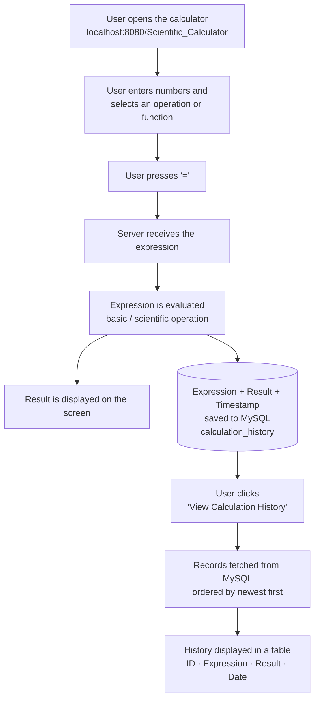

# 🧮 Scientific Calculator

A web-based **Scientific Calculator** that performs basic arithmetic and advanced scientific operations, and automatically **stores every calculation in a MySQL database** so users can review their past calculations on a dedicated history page.

---

## 👤 Author

**Alif Ahmed Joy**
Roll: **IT24015**

## 🎓 Supervised By

**Dr. Ziaur Rahman**
Professor
Department of ICT, MBSTU

---

## 📌 Project Overview

| Item | Details |
|------|---------|
| **Project Name** | Scientific Calculator |
| **Type** | Web Application |
| **Database** | MySQL (`scientific_calculator`) |
| **Local URL** | <http://localhost:8080/Scientific_Calculator/> |

---

## ✨ Features

- ➕ **Basic operations:** addition, subtraction, multiplication, division, percentage
- 🔬 **Scientific functions:** `sin`, `cos`, `tan`, `log`, `ln`, `√` (square root), `xʸ` (power)
- 📐 **Trigonometry in degrees** — e.g. `sin(90°) = 1`
- ⌫ **Editing controls:** `AC` (clear all) and `DEL` (delete last character)
- 💾 **Automatic history saving** — each calculation is saved to MySQL with its timestamp
- 📜 **Calculation History page** — view all past calculations (newest first) in a clean table
- 🎨 **Clean, responsive UI** with a modern card-style design

---

## 🖼️ Screenshots

### 1. Calculator Interface

Open the app at: **<http://localhost:8080/Scientific_Calculator/>**


### 2. Calculation History

Click **"View Calculation History"** at the bottom of the calculator to see every saved calculation with its ID, expression, result, and date/time.


### 3. MySQL Database – History Table

All calculations are stored in the `calculation_history` table of the `scientific_calculator` database.


---

## 🔄 Workflow

The application follows this step-by-step flow:



**In simple steps:**

1. **Input** – The user types numbers and picks an operator or scientific function (`sin`, `cos`, `tan`, `log`, `ln`, `√`, `xʸ`).
2. **Calculate** – On pressing `=`, the expression is sent to the backend and evaluated.
3. **Display** – The result is shown instantly on the calculator display.
4. **Store** – The expression, result, and current date-time are inserted into the `calculation_history` table in MySQL.
5. **Review** – Clicking **View Calculation History** retrieves all saved records from the database and shows them in a table, latest first.

---

## 🗄️ Database Design

**Database:** `scientific_calculator`
**Table:** `calculation_history`

| Column | Type | Description |
|--------|------|-------------|
| `id` | INT, PRIMARY KEY, AUTO_INCREMENT | Unique ID of each calculation |
| `expression` | VARCHAR | The expression entered by the user (e.g. `sin(90.0°)`) |
| `result` | DOUBLE / VARCHAR | Computed result |
| `created_at` | TIMESTAMP | Date and time of the calculation |

**Example SQL:**

```sql
CREATE DATABASE IF NOT EXISTS scientific_calculator
  CHARACTER SET utf8mb4 COLLATE utf8mb4_unicode_ci;

USE scientific_calculator;

CREATE TABLE IF NOT EXISTS calculation_history (
    id         INT AUTO_INCREMENT PRIMARY KEY,
    expression VARCHAR(255) NOT NULL,
    result     VARCHAR(100) NOT NULL,
    created_at TIMESTAMP DEFAULT CURRENT_TIMESTAMP
);
```

> 💡 Use `utf8mb4` so symbols like `√`, `×`, `÷`, and `°` are stored correctly (not as `?`).

---

## ⚙️ Installation & Setup

### Prerequisites

- JDK 8 or later
- Apache Tomcat (running on port **8080**)
- MySQL Server
- An IDE such as Eclipse / IntelliJ IDEA / NetBeans (optional)

### Steps

1. **Clone the repository**
   ```bash
   git clone https://github.com/<your-username>/Scientific_Calculator.git
   ```
2. **Create the database** – run the SQL script shown in the Database Design section in MySQL.
3. **Configure the database connection** – update the MySQL username, password, and URL in the project's database connection file.
4. **Add the MySQL JDBC driver** (`mysql-connector-j`) to the project's `lib` folder / dependencies.
5. **Deploy on Tomcat** – build the project and deploy it to Apache Tomcat.
6. **Run the application** – open your browser and visit:

   👉 **<http://localhost:8080/Scientific_Calculator/>**

---

## 🛠️ Technologies Used

| Layer | Technology |
|-------|------------|
| Frontend | HTML, CSS, JavaScript |
| Backend | Java (JSP / Servlet) on Apache Tomcat |
| Database | MySQL |

---

## 📂 Project Structure (Overview)

```
Scientific_Calculator/
├── calculator-ui.png           # README screenshots
├── calculation-history.png
├── mysql-history-table.png
├── src/                        # Backend source code
├── webapp/                     # Frontend pages (calculator + history)
└── README.md
```

---

## 🚀 Future Improvements

- Add more functions (factorial, inverse trigonometric, `π`, `e`)
- Degree / Radian mode toggle
- Option to clear or delete history records
- Keyboard input support
- Dark mode

---

## 🙏 Acknowledgement

This project was developed under the supervision of **Dr. Ziaur Rahman**, Professor, Department of ICT, MBSTU. Sincere thanks for the guidance and support.

---

## 📄 License

This project is created for academic and learning purposes.

---

<p align="center">Made with ❤️ by <b>Alif Ahmed Joy (IT24015)</b></p>
