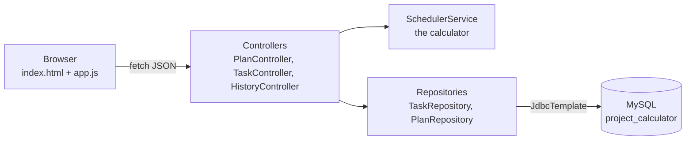
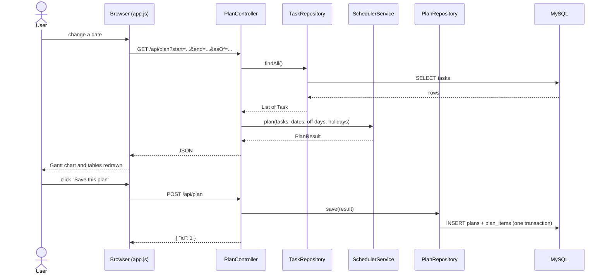
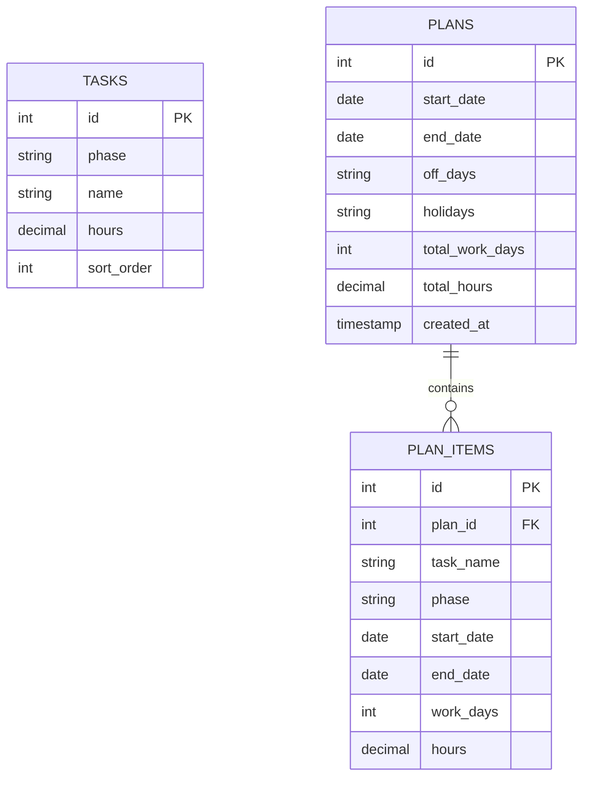

<div align="center">

# Project Calculator

**Give it a start date and a last date. It tells you what to finish every single day.**

A **Spring Boot** + MySQL web app that spreads your project tasks across the real working days between two dates, shows how much you can finish by any date you check, and redraws a Gantt chart every time you change a date.


</div>

---


## Table of contents

- [Why this exists](#why-this-exists)
- [Features](#features)
- [How the calculator works](#how-the-calculator-works)
- [Architecture](#architecture)
- [Tech stack](#tech-stack)
- [Database](#database)
- [Project structure](#project-structure)
- [Getting started](#getting-started)
- [Using the app](#using-the-app)
- [API](#api)
- [Tests](#tests)
- [Troubleshooting](#troubleshooting)
- [Roadmap](#roadmap)
- [License](#license)
- [Author](#author)

## Why this exists

Every student project has the same problem: a fixed last date and a long list of work. Most planners ask you to guess the dates for each task. This one works the other way round. You choose the dates, and the calculator answers three questions:

1. How much work must I finish **each day** to be done on time?
2. If I stop on **this date**, how much of the project will be done?
3. What does the whole plan **look like** on a calendar?

## Features

- **Date-driven planning.** Pick a start date and a last date. Tasks are placed one after another over the working days in between.
- **Check date.** Choose any date to see the hours done, the percentage, the finished tasks, the task in progress and the working days left.
- **Live Gantt chart.** Every change to a date, an off day or a holiday redraws the chart. A red line marks the check date, and each bar fills as work gets done.
- **Real working days.** Choose weekly off days (Friday and Saturday by default) and add holidays.
- **Day-by-day table.** For every working day: which task, how many hours, and how much of the project is done so far.
- **Editable task list.** Add or delete tasks in the browser. They are stored in MySQL and the plan recalculates at once.
- **Saved plans.** Save a calculation to the database and load its dates back later.
- **Zero setup database.** On the first start the app creates the database, the tables and the 17 sample tasks by itself.
- **Light and dark theme.** Follows the system setting.

## How the calculator works

The logic lives in one plain Java class, [`SchedulerService`](src/main/java/bd/mbstu/planner/service/SchedulerService.java). It does not touch the web layer or the database, so it is easy to test.

```
N           = working days between start and last date
                (minus weekly off days and holidays)
hoursPerDay = totalHours / N
task length = task.hours / hoursPerDay   (in working days)
hoursDone   = workingDaysUpToCheckDate * hoursPerDay
percentDone = hoursDone / totalHours
```

Every working day carries the same amount of work, and tasks are placed in order. A day can hold the end of one task and the start of the next.

**Worked example** with the 17 sample tasks, 8 Nov 2026 to 31 Jan 2027, Friday and Saturday off:

| | |
|---|---|
| Calendar days | 85 |
| Working days | 61 |
| Total work | 152 hours |
| Work each day | about 2.5 hours |
| Check date 20 Dec 2026 | 31 working days, about 77.2 hours done (50.8%), 9 tasks finished |

## Architecture



The browser never calculates dates itself. It sends the dates to `/api/plan`, gets the finished plan back as JSON, and only draws it.

### Request flow



## Tech stack

| Part | Technology |
|---|---|
| Language | Java 17 |
| Framework | Spring Boot 3.3 (Spring Web, Spring JDBC) |
| Web server | Embedded Tomcat 10.1 |
| Database | MySQL 8 with `JdbcTemplate` and the HikariCP pool |
| JSON | Jackson |
| Build | Maven, with the Maven Wrapper (`mvnw.cmd`) |
| Tests | JUnit 5 |
| Frontend | HTML, CSS and plain JavaScript. No framework, no external library |

## Database



`tasks` holds the work to be done. `plans` and `plan_items` keep a snapshot of every saved calculation.

## Project structure

```
project-calculator/
|-- pom.xml                                  Spring Boot 3.3, JDBC, MySQL driver, JUnit
|-- mvnw, mvnw.cmd, .mvn/                    Maven Wrapper (no Maven install needed)
|-- LICENSE
|-- docs/
|   `-- screenshot.png
|-- sql/
|   `-- schema.sql                           optional manual script (MySQL Workbench)
`-- src/
    |-- main/
    |   |-- java/bd/mbstu/planner/
    |   |   |-- ProjectCalculatorApplication.java    start class (@SpringBootApplication)
    |   |   |-- model/                       Task, PlanResult, PlanSummary
    |   |   |-- service/                     SchedulerService  (the calculator)
    |   |   |-- repository/                  TaskRepository, PlanRepository,
    |   |   |                                SampleDataLoader
    |   |   `-- controller/                  PlanController, TaskController,
    |   |                                    HistoryController, PlanRequest,
    |   |                                    ApiExceptionHandler
    |   `-- resources/
    |       |-- application.properties       port and MySQL settings
    |       |-- schema.sql                   creates the tables when missing
    |       `-- static/
    |           |-- index.html
    |           |-- css/style.css
    |           `-- js/app.js                calls the API, draws the Gantt chart
    `-- test/java/bd/mbstu/planner/
        `-- SchedulerServiceTest.java
```

## Getting started

### Requirements

- JDK 17 or newer
- MySQL 8, running on port 3306

You do **not** need to install Maven or Tomcat. The Maven Wrapper downloads Maven, and Tomcat is built into the app.

### 1. Set the database password

The app reads the password from the `DB_PASSWORD` environment variable. In **PowerShell**:

```powershell
$env:DB_PASSWORD = "your_mysql_password"
```

You can also edit `src/main/resources/application.properties`:

```properties
spring.datasource.url=jdbc:mysql://localhost:3306/project_calculator?createDatabaseIfNotExist=true&useSSL=false&allowPublicKeyRetrieval=true&serverTimezone=Asia/Dhaka
spring.datasource.username=${DB_USER:root}
spring.datasource.password=${DB_PASSWORD:your_mysql_password}
```

> Do not commit your real password. Using the `DB_PASSWORD` variable keeps it out of Git.

### 2. Run

Run this in the folder that contains `pom.xml`:

```powershell
cd C:\Projects\project-calculator
.\mvnw.cmd spring-boot:run
```

Open **http://localhost:8080**

The first start creates the `project_calculator` database, the 3 tables and the 17 sample tasks. You can check them in MySQL:

```sql
SELECT COUNT(*) FROM project_calculator.tasks;   -- should print 17
```

### Build a JAR

```powershell
.\mvnw.cmd clean package -DskipTests
java -jar .\target\project-calculator.jar
```

### Run on another port

```powershell
.\mvnw.cmd spring-boot:run "-Dspring-boot.run.arguments=--server.port=9090"
```

### Run from IntelliJ IDEA

1. **File > Open** and select the folder that contains `pom.xml`. Wait for Maven to finish.
2. Open `ProjectCalculatorApplication.java` and click the green run arrow.
3. If your password is different, go to **Run > Edit Configurations > Environment variables** and add `DB_PASSWORD=yourpassword`.
4. Open http://localhost:8080

### Optional: create the database by hand

If you prefer MySQL Workbench, run [`sql/schema.sql`](sql/schema.sql). In **PowerShell** the `<` operator does not work, so use the `source` command:

```powershell
mysql -u root -p
```

```sql
source C:/Projects/project-calculator/sql/schema.sql
```

## Using the app

1. Set the **start date** and the **last date**.
2. Optionally set a **check date** to see the progress up to that day.
3. Tick the **weekly off days** and type any **holidays** as `yyyy-mm-dd`, separated by commas.
4. Read the summary cards, the Gantt chart, the task schedule and the day-by-day table.
5. Use **Save this plan** to store the result in MySQL. **Use these dates** in the Saved plans list loads it back.
6. Add or delete tasks in the **Tasks** section. The plan updates at once.

## API

| Method | Endpoint | Purpose |
|---|---|---|
| GET | `/api/plan?start=&end=&asOf=&offDays=&holidays=` | Calculate a plan |
| POST | `/api/plan` (same parameters) | Calculate and save |
| GET | `/api/tasks` | List tasks |
| POST | `/api/tasks` with `action=add&phase=&name=&hours=` | Add a task |
| POST | `/api/tasks` with `action=delete&id=` | Delete a task |
| GET | `/api/history` | The 20 most recent saved plans |

Example:

```
GET /api/plan?start=2026-11-08&end=2027-01-31&asOf=2026-12-20&offDays=FRIDAY,SATURDAY
```

```json
{
  "startDate": "2026-11-08",
  "endDate": "2027-01-31",
  "totalCalendarDays": 85,
  "totalWorkDays": 61,
  "totalHours": 152.0,
  "hoursPerDay": 2.49,
  "tasks": [ { "name": "Requirement analysis", "startDate": "2026-11-08", "...": "..." } ],
  "daily": [ "..." ],
  "progress": { "asOf": "2026-12-20", "percentDone": 50.8, "...": "..." }
}
```

A bad date or an empty task list returns HTTP 400 with `{ "error": "..." }`. A database problem returns HTTP 500 with the same shape. This is handled in one place by `ApiExceptionHandler`.

## Tests

```powershell
.\mvnw.cmd test
```

The JUnit tests check the working-day count, that the tasks cover the full date range in order, the progress at a check date, the date validation, and that the daily hours add up to the total. They test `SchedulerService` only, so no database is needed.

## Troubleshooting

| Problem | Fix |
|---|---|
| `Access denied for user 'root'` | Wrong password. Set `$env:DB_PASSWORD` in the same PowerShell window you run the app from. |
| `Communications link failure` | The MySQL service is not running, or it is not on port 3306. |
| `Port 8080 was already in use` | Stop the other program (an old Tomcat, for example) or use another port, see [Run on another port](#run-on-another-port). |
| `JAVA_HOME is not defined correctly` | Set it in PowerShell: `$env:JAVA_HOME = "C:\Program Files\Java\jdk-17"` |
| `invalid target release: 17` or `release version 17 not supported` | Your JDK is older than 17. Install JDK 17 or newer. |
| `There is no POM in this directory` | Run the command inside the folder that contains `pom.xml`. |
| `mvnw.cmd` cannot be found | Use `.\mvnw.cmd` with the `.\` in front, in PowerShell. |
| The page loads but shows no tasks | Check the console for a database error. The tasks table must not be empty. Restart the app to reload the sample tasks. |
| Old behaviour after a code change | Stop the app, run `.\mvnw.cmd clean spring-boot:run`, and refresh the browser with Ctrl+F5. |

## Roadmap

- Task dependencies and parallel tasks
- Different hours for different days of the week
- Drag the Gantt bars to adjust a task
- Export the plan as CSV or PDF
- Mark tasks as done and compare the real progress with the plan
- User login with Spring Security

## License

Released under the MIT License. See the [`LICENSE`](LICENSE) file.

## Author

**Alif Ahmed Joy**  
ID: **IT24015**  
Department of Information and Communication Technology, Mawlana Bhashani Science and Technology University (MBSTU), Bangladesh

**Supervised by**  
Dr. Ziaur Rahman  
Professor  
Department of ICT, MBSTU
