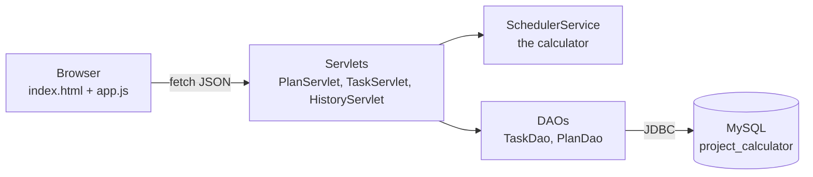
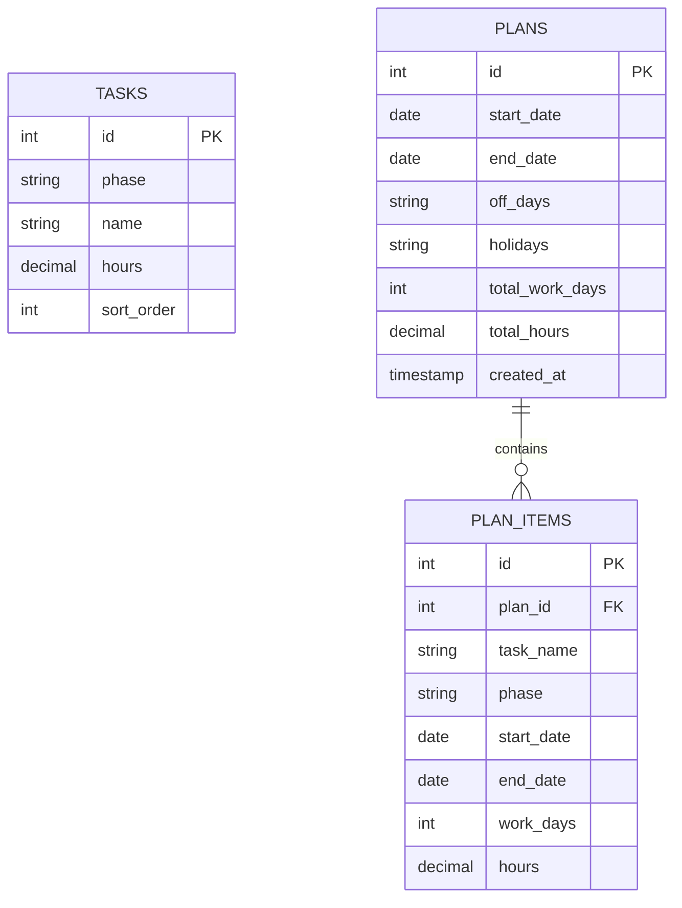

<div align="center">

# Project Calculator

**Give it a start date and a last date. It tells you what to finish every single day.**

A Java Servlet + MySQL web app that spreads your project tasks across the real working days between two dates, shows how much you can finish by any date you check, and redraws a Gantt chart every time you change a date.

</div>

---


## Why this exists

Every student project has the same problem: a fixed last date and a long list of work. Most planners ask you to guess the dates for each task. This one works the other way round. You choose the dates, and the calculator answers three questions:

1. How much work must I finish **each day** to be done on time?
2. If I stop on **this date**, how much of the project will be done?
3. What does the whole plan **look like** on a calendar?

## Features

- **Date-driven planning.** Pick a start date and a last date. Tasks are placed one after another over the working days in between.
- **Check date.** Choose any date to see the hours done, the percentage, the finished tasks, the task in progress and the working days left.
- **Live Gantt chart.** Every change to a date, an off day or a holiday redraws the chart. A red line marks the check date, and each bar fills as work gets done.
- **Real working days.** Choose weekly off days (Friday and Saturday by default) and add holidays.
- **Day-by-day table.** For every working day: which task, how many hours, and how much of the project is done so far.
- **Editable task list.** Add or delete tasks in the browser. They are stored in MySQL and the plan recalculates at once.
- **Saved plans.** Save a calculation to the database and load its dates back later.
- **Light and dark theme.** Follows the system setting.

## How the calculator works

The logic lives in one plain Java class, [`SchedulerService`](src/main/java/bd/mbstu/planner/service/SchedulerService.java). It does not touch the servlet or the database, so it is easy to test.

```
N           = working days between start and last date
                (minus weekly off days and holidays)
hoursPerDay = totalHours / N
task length = task.hours / hoursPerDay   (in working days)
hoursDone   = workingDaysUpToCheckDate * hoursPerDay
percentDone = hoursDone / totalHours
```

Every working day carries the same amount of work, and tasks are placed in order. A day can hold the end of one task and the start of the next.

**Worked example** with the 17 sample tasks, 8 Nov 2026 to 31 Jan 2027, Friday and Saturday off:

| | |
|---|---|
| Calendar days | 85 |
| Working days | 61 |
| Total work | 152 hours |
| Work each day | about 2.5 hours |
| Check date 20 Dec 2026 | 31 working days, about 77.2 hours done (50.8%), 9 tasks finished |

## Architecture



The browser never calculates dates itself. It sends the dates to `/api/plan`, gets the finished plan back as JSON, and only draws it.

## Tech stack

| Part | Technology |
|---|---|
| Language | Java 17 |
| Web layer | Jakarta Servlet 6.0 (Tomcat 10.1) |
| Database | MySQL 8 through JDBC |
| JSON | Gson |
| Build | Maven (WAR) |
| Tests | JUnit 5 |
| Frontend | HTML, CSS and plain JavaScript. No framework, no external library |

## Database



`tasks` holds the work to be done. `plans` and `plan_items` keep a snapshot of every saved calculation.

## Project structure

```
ProjectCalculator/
|-- pom.xml
|-- sql/
|   `-- schema.sql                         database, 3 tables, 17 sample tasks
`-- src/
    |-- main/
    |   |-- java/bd/mbstu/planner/
    |   |   |-- model/                     Task, PlanResult, PlanSummary
    |   |   |-- util/                      DBConnection, Json
    |   |   |-- dao/                       TaskDao, PlanDao
    |   |   |-- service/                   SchedulerService  (the calculator)
    |   |   `-- servlet/                   PlanServlet, TaskServlet,
    |   |                                  HistoryServlet, PlanRequest
    |   |-- resources/
    |   |   `-- db.properties              MySQL url, user, password
    |   `-- webapp/
    |       |-- index.html
    |       |-- css/style.css
    |       |-- js/app.js                  calls the API, draws the Gantt chart
    |       `-- WEB-INF/web.xml
    `-- test/java/bd/mbstu/planner/
        `-- SchedulerServiceTest.java
```

## Getting started

### Requirements

- JDK 17
- Maven 3.8 or newer
- MySQL 8
- Apache Tomcat **10.1** (it uses `jakarta.*`, so Tomcat 9 will not work with this version)

### 1. Create the database

Open MySQL and run [`sql/schema.sql`](sql/schema.sql). In **PowerShell** the `<` operator does not work, so use the `source` command:

```powershell
mysql -u root -p
```

```sql
source C:/path/to/ProjectCalculator/sql/schema.sql
SELECT COUNT(*) FROM project_calculator.tasks;   -- should print 17
```

### 2. Set the database password

Edit `src/main/resources/db.properties`:

```properties
driver=com.mysql.cj.jdbc.Driver
url=jdbc:mysql://localhost:3306/project_calculator?useSSL=false&allowPublicKeyRetrieval=true&serverTimezone=Asia/Dhaka
user=root
password=your_mysql_password
```

> Do not commit your real password. Keep it out of Git, or add `db.properties` to `.gitignore` and share a `db.properties.example` instead.

### 3. Build

Run this in the folder that contains `pom.xml`:

```bash
mvn clean package
```

This creates `target/project-calculator.war`.

### 4. Deploy and run on Tomcat

Windows PowerShell:

```powershell
$env:CATALINA_HOME = "C:\apache-tomcat-10.1.61"      # the Tomcat folder, NOT its \bin folder
$env:JAVA_HOME     = "C:\Program Files\Java\jdk-17"

Copy-Item .\target\project-calculator.war "$env:CATALINA_HOME\webapps\"
& "$env:CATALINA_HOME\bin\catalina.bat" run
```

Linux or macOS:

```bash
cp target/project-calculator.war $CATALINA_HOME/webapps/
$CATALINA_HOME/bin/catalina.sh run
```

Open **http://localhost:8080/project-calculator/**

### Run from IntelliJ IDEA

1. **File > Open** and select the folder that contains `pom.xml`.
2. **Run > Edit Configurations > + > Tomcat Server > Local** and select your Tomcat 10.1 folder.
3. On the **Deployment** tab add the artifact `project-calculator:war exploded` and set the application context to `/project-calculator`.
4. Run it.

## Using the app

1. Set the **start date** and the **last date**.
2. Optionally set a **check date** to see the progress up to that day.
3. Tick the **weekly off days** and type any **holidays** as `yyyy-mm-dd`, separated by commas.
4. Read the summary cards, the Gantt chart, the task schedule and the day-by-day table.
5. Use **Save this plan** to store the result in MySQL. **Use these dates** in the Saved plans list loads it back.
6. Add or delete tasks in the **Tasks** section. The plan updates at once.

## API

| Method | Endpoint | Purpose |
|---|---|---|
| GET | `/api/plan?start=&end=&asOf=&offDays=&holidays=` | Calculate a plan |
| POST | `/api/plan` (same parameters) | Calculate and save |
| GET | `/api/tasks` | List tasks |
| POST | `/api/tasks` with `action=add&phase=&name=&hours=` | Add a task |
| POST | `/api/tasks` with `action=delete&id=` | Delete a task |
| GET | `/api/history` | The 20 most recent saved plans |

Example:

```
GET /api/plan?start=2026-11-08&end=2027-01-31&asOf=2026-12-20&offDays=FRIDAY,SATURDAY
```

```json
{
  "startDate": "2026-11-08",
  "endDate": "2027-01-31",
  "totalCalendarDays": 85,
  "totalWorkDays": 61,
  "totalHours": 152.0,
  "hoursPerDay": 2.49,
  "tasks": [ { "name": "Requirement analysis", "startDate": "2026-11-08", "...": "..." } ],
  "daily": [ "..." ],
  "progress": { "asOf": "2026-12-20", "percentDone": 50.8, "...": "..." }
}
```

A bad date or an empty task list returns HTTP 400 with `{ "error": "..." }`.

## Tests

```bash
mvn test
```

The JUnit tests check the working-day count, that the tasks cover the full date range in order, the progress at a check date, the date validation, and that the daily hours add up to the total.

## Troubleshooting

| Problem | Fix |
|---|---|
| `404` on `/project-calculator/` | You are probably on Tomcat 9 or older. This build needs Tomcat 10.1. Also check that `webapps/project-calculator` was created. |
| `The CATALINA_HOME environment variable is not defined correctly` | Point `CATALINA_HOME` at the main Tomcat folder, not at `bin`. |
| `Access denied for user 'root'` | Wrong password in `db.properties`. |
| `Communications link failure` | The MySQL service is not running. |
| `Unknown database 'project_calculator'` | `schema.sql` was not run. |
| `There is no POM in this directory` | Run `mvn` inside the folder that contains `pom.xml`. |
| Old behaviour after a rebuild | Delete `webapps/project-calculator*` before copying the new WAR. |

## Roadmap

- Task dependencies and parallel tasks
- Different hours for different days of the week
- Drag the Gantt bars to adjust a task
- Export the plan as CSV or PDF
- Mark tasks as done and compare the real progress with the plan

## License

Released under the MIT License. Add a `LICENSE` file to the repository root to make it official.

## Author

**Alif Ahmed Joy**  
Department of Information and Communication Technology, Mawlana Bhashani Science and Technology University (MBSTU), Bangladesh

**Supervised by**  
Dr. Ziaur Rahman  
Professor  
Department of ICT, MBSTU
